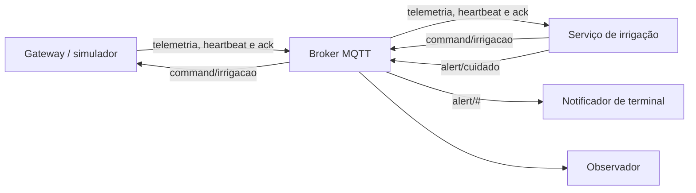

# Alertas de cuidado — Marco 3

O serviço passa a consumir telemetria e confirmações e produzir comandos e
alertas. O notificador é um assinante independente, somente leitura; aplicativo
e Alexa reais permanecem fora do escopo. Todos usam a configuração compartilhada
e o mesmo broker, Aedes local ou MQTT externo via `MQTT_URL`.



## Contrato e gatilhos

Publicação: `naodenemagua/v1/vaso/{vasoId}/alert/cuidado`, **QoS 1, retain false**.
Filtro do notificador: `naodenemagua/v1/vaso/{vasoId}/alert/#`. O prefixo e o vaso
seguem `TOPIC_PREFIX` e `VASO_ID`. O observador mantém os quatro tópicos anteriores
e acrescenta esse filtro. O notificador só apresenta `AlertaCuidado` no tópico
previsto e para o vaso configurado.

O schema [AlertaCuidado v1](../contrato/v1/alerta-cuidado.schema.json) é draft
2020-12, fechado a campos desconhecidos, validado pelo módulo compartilhado tanto
na emissão quanto na recepção. Todos os campos do exemplo são obrigatórios.
`issuedAt` exige data válida UTC com sufixo Z; `ttlMs` é inteiro positivo.

| Tipo | Gatilho | Severidade | correlationId |
|---|---|---|---|
| SOLO_SECO | transição para AUTORIZADO | ATENCAO | eventId da leitura que autorizou |
| IRRIGACAO_EXECUTADA | ack EXECUTADO de PULSO_IRRIGACAO | INFO | commandId |
| IRRIGACAO_RECUSADA | ack REJEITADO_* de PULSO_IRRIGACAO | ATENCAO | commandId |
| DADO_OBSOLETO | transição por validade_expirada | ATENCAO | eventId da última leitura válida |
| DISPOSITIVO_OFFLINE | transição para offline via LWT | CRITICO | eventId do LWT, ou deviceId existente |
| DISPOSITIVO_RECUPERADO | falha conhecida para NORMAL | INFO | eventId da leitura de recuperação |

DESCONHECIDO inicial não significa dispositivo recuperado. Leituras históricas
`replayed: true`, inclusive inválidas, não alteram estado nem geram alertas.
SOLO_SECO e OFFLINE só são emitidos na transição; leituras e LWT repetidos não
produzem novas notificações. Uma recuperação para AGUARDANDO não emite recuperação.

```json
{
  "schemaVersion": 1,
  "eventId": "servico-irrigacao:9acb77e5-bb76-46f2-bdeb-71f7489b0265:000001",
  "eventType": "AlertaCuidado",
  "producerId": "servico-irrigacao",
  "entityId": "vaso-01",
  "alertType": "SOLO_SECO",
  "severity": "ATENCAO",
  "message": "O vaso-01 está com o solo seco há 3 leituras. Irrigação autorizada.",
  "correlationId": "sim-vaso-01:b7f3a2:000042",
  "issuedAt": "2026-10-16T14:32:05.120Z",
  "ttlMs": 60000
}
```

## Identidade, confirmação e tempo

Um UUID gerado a cada início do serviço e um contador formam
`servico-irrigacao:{executionId}:{sequence}`. O log existente `eventos.jsonl`
registra eventId, correlationId, alertType e severity. Quando o LWT não tem
eventId, o log ORIGEM_LWT preserva o payload, bootId e tópico junto ao deviceId
usado como correlação; esse valor identifica o dispositivo, sem alegar identificar
uma ocorrência única do LWT.

O emissor mantém os últimos **500 comandos**, com ação, origem e confirmação
terminal. Acks são associados por commandId, correlationId, deviceId e bootId
quando disponível; podem chegar fora de ordem. Duplicatas ou resultados posteriores
ao primeiro ack terminal não produzem novo alerta. IGNORADO_DUPLICADO não indica
nova execução e permite aguardar um EXECUTADO original que chegue depois;
PARAR_IRRIGACAO não produz alerta de irrigação executada ou recusada.
Um ack de comando desconhecido ou já removido do registro não gera alerta.

Publicar comando expressa intenção. PUBACK confirma transporte MQTT. Somente o
ack de negócio EXECUTADO do pulso informa a atuação declarada pelo dispositivo.
O LED continua representando a bomba; não há realimentação física de água.

O notificador guarda os últimos **500 eventIds** aceitos e descarta duplicatas,
JSON malformado, versão desconhecida, schema inválido e alertas vencidos, com
motivos legíveis no console. A validade é `Date.now() >= issuedAt + ttlMs`, com
tempo absoluto UTC; não usa `millis()` do ESP32. O padrão é 60000 ms, alterável em
`config.json` (`alertas.ttlMs`) ou `ALERTA_TTL_MS` no serviço.

Ambos os processos reconectam ao broker e refazem assinaturas. Alertas não são
retidos: um notificador desconectado pode perder notificações. Estado e caches
não persistem entre reinícios; mensagens antigas fora da janela de 500 IDs podem
ser vistas de novo enquanto válidas. Relógios do serviço e notificador precisam
estar sincronizados. Ctrl+C encerra o cliente MQTT; cores são usadas em TTY e
podem ser desativadas com `NO_COLOR=1`.

## Demonstração e testes no Windows PowerShell

Na pasta `marco-03`, execute `npm install`. Abra quatro terminais nessa pasta:

| Terminal | Comando |
|---|---|
| 1 | `npm run broker` |
| 2 | `npm run servico` |
| 3 | `npm run simulador` |
| 4 | `npm run notificador` |

No simulador: `s` provoca solo seco, `m` normaliza, `p` pausa leituras para expirar
o dado e `k` derruba a conexão para disparar LWT. Ao retornar leitura normal,
observe recuperação. Opcionalmente, `npm run observador` acompanha toda a fronteira.
Use `npm run teste` para verificar o ciclo completo sem internet.

Com Wokwi, o serviço e o notificador precisam do mesmo broker do firmware:

```powershell
$env:MQTT_URL="mqtt://broker.hivemq.com:1883"
npm run servico
```

Em outro terminal, repita a atribuição e execute `npm run notificador`. Prefixo
e vaso devem coincidir em todos os componentes. Não execute o broker local nesse
caminho. O teste automatizado usa Aedes local; Wokwi e broker público exigem uma
verificação manual com internet.

## Preparação para segurança e ACL

Na próxima etapa, três identidades distintas limitarão permissões:

| Identidade | Publica | Assina |
|---|---|---|
| Gateway | telemetria, heartbeat e confirmações | comandos |
| Serviço de irrigação | comandos e alertas | telemetria, heartbeat e confirmações |
| Notificador | nada | exclusivamente alert/# |

O teste futuro de ACL deve conectar com a identidade do notificador, tentar
publicar em `command/irrigacao` e verificar a recusa no broker e a ausência de
comando entregue ao gateway. Nenhuma autenticação ou ACL é implementada agora;
a separação atual é de responsabilidades do código.
