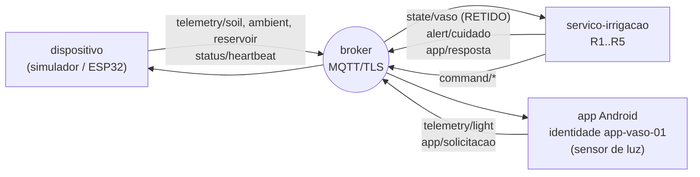
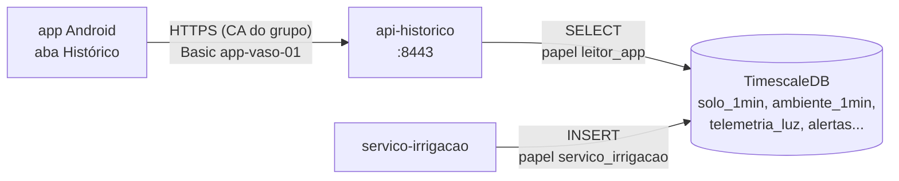

# Aplicativo Android — integração com o sistema

> **Situação:**
> - **Fase 1 (backend):** concluída — identidade, contratos, tópicos, tratamento no serviço e testes.
> - **Fase 2 (app):** concluída — projeto Android em [`app-android/`](../app-android),
>   login, conexão MQTT/TLS com a CA do grupo, estados de conexão e painel de status.
>   Testado no Galaxy A16 (Android 16) pelo cabo USB — §6.
> - **Fase 3 (telas):** concluída — abas **Vaso** (solo, ar, reservatórios,
>   nutrientes, dispositivo) e **Alertas**, e o botão **Reconhecer falha** com
>   carregando / sem resposta / resultado. Fluxo app → serviço → bomba verificado
>   no aparelho — §6.1.
> - **Fase 4 (sensor de luz):** concluída — o app é também **produtor**:
>   publica `LeituraLuz` do sensor do celular; o serviço aplica a regra **R5**
>   (média, histerese, tempo mínimo, validade, atraso) e alerta — §7.
> - **Fase 5 (histórico):** concluída — API HTTPS **somente leitura**
>   ([`api-historico/`](../api-historico)) sobre o TimescaleDB, com o papel
>   `leitor_app`; aba **Histórico** no app com gráficos e os alertas do banco — §8.

O app entra como previsto desde o Marco 2: **mais um cliente do broker**, sem
mudar a regra de irrigação. Ele **não comanda atuador**. Lê o estado e os
alertas, faz **pedidos** ao serviço, que decide, e **produz** um dado novo: a luz
medida pelo próprio celular.



## 1. Tópicos e contratos

| Tópico | Sentido | Contrato | QoS | Retido |
|---|---|---|---|:---:|
| `naodenemagua/v1/vaso/{vasoId}/state/vaso` | serviço → app | [`EstadoVaso`](../contrato/v1/estado-vaso.schema.json) | 1 | **sim** |
| `naodenemagua/v1/vaso/{vasoId}/app/solicitacao` | app → serviço | [`SolicitacaoApp`](../contrato/v1/solicitacao-app.schema.json) | 1 | não |
| `naodenemagua/v1/vaso/{vasoId}/app/resposta` | serviço → app | [`RespostaApp`](../contrato/v1/resposta-app.schema.json) | 1 | não |
| `naodenemagua/v1/vaso/{vasoId}/telemetry/light` | **app → serviço** | [`LeituraLuz`](../contrato/v1/telemetria-luz.schema.json) | 1 | não |
| `naodenemagua/v1/vaso/{vasoId}/alert/#` | serviço → app | `AlertaCuidado` (Marco 3) | 1 | não |
| `naodenemagua/v1/vaso/{vasoId}/telemetry/#`, `status/#` | dispositivo → app | contratos do Marco 2/4 | 1 | heartbeat sim |

### `EstadoVaso` — o que o app mostra ao abrir

O serviço já mantém o estado do vaso (solo, ar, reservatórios, bloqueios,
adubação). O app **não recalcula regra nenhuma**: recebe a fotografia que o
serviço publica, **retida** — quem assina recebe a última na hora.

- Publicado **a cada mudança** e, sem mudança, a cada `app.estadoIntervaloMs`
  (5 s). Uma mensagem retida sobrevive ao serviço; por isso o pulso: se
  `generatedAt` ficar mais velho que ~3× `publishIntervalMs`, o app mostra
  **“serviço sem resposta”** em vez de dados velhos como se fossem atuais.
- `falhaPendente: true` é quando o app habilita o botão **Reconhecer falha**.

Exemplo:

```json
{
  "schemaVersion": 1, "eventType": "EstadoVaso", "producerId": "servico-irrigacao",
  "entityId": "vaso-01", "generatedAt": "2026-11-24T18:03:12.512Z", "publishIntervalMs": 5000,
  "solo": { "estado": "NORMAL", "umidadePct": 58, "idadeMs": 820, "bombaLigada": false, "autorizado": false },
  "ar": { "estado": "NORMAL", "umidadePct": 61.3, "temperaturaC": 24.5, "umidificadorLigado": false },
  "reservatorios": { "AGUA": { "estado": "OK", "nivelPct": 72 }, "ADUBO": { "estado": "OK", "nivelPct": 80 } },
  "irrigacao": { "bloqueada": false, "motivo": null },
  "adubacao": { "estado": "OCIOSO", "ec25UsCm": 1180, "dosesNaJanela": 0, "excesso": false },
  "falhaPendente": false,
  "falhasPendentes": []
}
```

### `SolicitacaoApp` → `RespostaApp` — o caminho de volta

Hoje há uma ação: **`RECONHECER_FALHA`** — o usuário viu `FALHA_IRRIGACAO` /
`FALHA_ADUBACAO` e libera as regras bloqueadas. É **a mesma função** que a tecla
`r` do serviço (`reconhecerFalhas()` em
[`main.js`](../consumidor-servico/src/main.js)): o app não tem um caminho com
regra diferente da demonstração no terminal.

```json
{ "schemaVersion": 1, "eventType": "SolicitacaoApp", "requestId": "3f2a9c1e-7b1d-4e55-9a10-0c4e2b7d8f11",
  "deviceId": "app-vaso-01", "entityId": "vaso-01", "action": "RECONHECER_FALHA",
  "createdAt": "2026-11-24T18:04:00.000Z", "ttlMs": 30000 }
```

| `result` | Quando | O app mostra |
|---|---|---|
| `EXECUTADA` | havia bloqueio e foi liberado (`liberou.irrigacao` / `liberou.adubacao`) | sucesso |
| `NADA_A_RECONHECER` | pedido válido, sem falha pendente | informação |
| `IGNORADA_DUPLICADA` | `requestId` já tratado — **o efeito não se repete**; `detail` traz o resultado original | o resultado original |
| `REJEITADA_EXPIRADA` | chegou depois de `createdAt + ttlMs`, ou `createdAt` mais de 30 s no futuro | “pedido expirou, tente de novo” |
| `REJEITADA_CONTRATO` | fora do schema ou de outro vaso | erro |

O `requestId` é a chave de idempotência: o app pode reenviar o mesmo pedido
depois de uma falha de rede sem medo de efeito duplo. Sem resposta em alguns
segundos, o app mostra **falha de comunicação** (o broker pode estar fora).

## 2. Segurança

| Camada | Como vale para o app |
|---|---|
| Canal | **MQTT sobre TLS** (`mqtts://`, 8883). O app embute o `ca.crt` da CA do grupo (público) e confere o nome do servidor. |
| Identidade | Usuário/senha próprios: `app-vaso-01`. `clientId` precisa começar por `app-vaso-01`. |
| Autorização | Papel **`app`** em [`acl.json`](../seguranca/acl.json): só o **próprio vaso**; **publica apenas `app/solicitacao`**; não assina `command/*`. O broker confere que o `deviceId` do pedido é o da identidade autenticada. |
| Credenciais administrativas | **Fora do app.** A senha do `servico-irrigacao`, a chave da CA, as chaves HMAC e as senhas do banco ficam na máquina do serviço. O app só tem a sua senha, digitada na tela de login (não vai no código nem no Git). |

Por que o app não usa HMAC: o HMAC existe para o caminho B (broker público, sem
ACL). O app só usa o caminho A, onde o broker autentica e autoriza cada
publicação. Uma chave HMAC dentro do APK também não seria segredo — qualquer um
pode extrair um APK.

## 3. Conectar o celular ao broker

**Senha do app.** `npm run seguranca` cria a senha do `app-vaso-01` sem trocar
as demais (identidade nova na ACL ganha senha; as antigas ficam). Ela fica em
`seguranca/segredos.json` (fora do Git).

**Opção A — cabo USB (recomendada para a demonstração).** O celular acessa o
broker como `localhost`, e o certificado de sempre vale:

```powershell
& "$env:LOCALAPPDATA\Android\Sdk\platform-tools\adb.exe" reverse tcp:8883 tcp:8883
```

O redirecionamento some ao desconectar o cabo; rode de novo depois.

**Opção B — Wi-Fi.** O app usa o IP desta máquina, e o certificado do broker
precisa nomear esse IP. Reemita só o certificado do broker, pela **mesma CA**
(o app não precisa ser reinstalado e as senhas não mudam):

```powershell
npm run seguranca -- --broker-host 192.168.10.152
```

Depois reinicie o broker e libere a porta 8883 no Firewall do Windows. O IP
muda de rede para rede.

## 4. Testes

Seção **19** de `npm run teste` (21 verificações, o teste faz o papel do app):

- identidade própria, TLS + senha;
- `EstadoVaso` **retido** chega ao assinar, dentro do contrato, e é republicado no pulso;
- ACL: o app **não** assina `command/#` nem outro vaso; publicar comando derruba a
  conexão; `deviceId` falsificado é negado; o gateway não pode pedir como app;
- `NADA_A_RECONHECER`, `REJEITADA_EXPIRADA` (pedido velho e relógio adiantado),
  `REJEITADA_CONTRATO` (`LIGAR_BOMBA`);
- falha real (bomba sem fluxo) → `falhaPendente` no estado → reconhecimento
  `EXECUTADA` → irrigação volta **antes** do bloqueio vencer sozinho;
- retry do mesmo `requestId` → `IGNORADA_DUPLICADA`, sem repetir o efeito.

Evidência: [`evidencias/teste-integracao.txt`](evidencias/teste-integracao.txt).

## 5. O app Android (`app-android/`)

| | |
|---|---|
| Linguagem / UI | Kotlin + Jetpack Compose (Material 3) |
| Build | Android Gradle Plugin 9.5.2, Gradle 9.6.0 (wrapper), `compileSdk`/`targetSdk` 37, `minSdk` 26 |
| MQTT | Eclipse Paho `mqttv3` 1.2.5 (MQTT 3.1.1, QoS 1, sessão limpa, reconexão automática) |
| Preferências | DataStore (servidor, porta, usuário, vaso; senha só se marcar “lembrar”) |

Estrutura:

```
app-android/app/src/main/java/br/ufg/naodenemagua/
├── conexao/TlsDoGrupo.kt     confia SÓ na CA do grupo (res/raw, copiada no build)
├── conexao/ConexaoMqtt.kt    cliente MQTT/TLS, estados de conexão, tradução das falhas
├── conexao/Topicos.kt        tópicos do vaso (iguais a contrato/index.js)
├── contrato/Contratos.kt     leitura dos contratos v1; fora do contrato -> descartado
├── dados/Preferencias.kt     dados de conexão no aparelho
└── ui/                       AppViewModel, LoginTela, PainelTela
```

**A CA entra no build, não no Git.** A tarefa `copiarCaDoGrupo`
([`app/build.gradle.kts`](../app-android/app/build.gradle.kts)) copia
`seguranca/certs/ca.crt` para `res/raw/ca_naodenemagua.crt` a cada compilação.
Sem `npm run seguranca` antes, o build para com uma mensagem dizendo isso. O app
**não confia nas CAs do sistema** e confere se o certificado do broker nomeia o
host usado.

**Estados que o usuário vê** (o PDF exige carregamento, falha de comunicação e
resultado):

| Estado | Quando | Tela |
|---|---|---|
| Conectando | handshake TLS + CONNECT em curso | indicador girando |
| Conectado | CONNACK aceito e assinaturas feitas | verde, “há X s” |
| Reconectando | a conexão caiu depois de estabelecida | amarelo; serviço e dispositivo passam a “sem conexão” (não se afirma o que não se sabe) |
| Falha | a primeira conexão falhou | vermelho, com o motivo e a ação: senha inválida, identidade não autorizada, certificado de outra CA, certificado que não vale para o endereço, broker inalcançável, tempo esgotado |
| Serviço sem resposta | conectado, mas o `EstadoVaso` não é renovado há mais de 3 pulsos | vermelho no cartão do serviço |

### Compilar e instalar

Pré-requisitos: Android Studio (traz o JDK e o SDK) e `npm run seguranca` já
executado em `marco-04` (gera a CA). Pelo Android Studio: abrir `app-android/`,
esperar o *Gradle sync* e clicar em **Run** com o celular conectado. Pelo terminal:

```powershell
$env:JAVA_HOME = "C:\Program Files\Android\Android Studio\jbr"; cd app-android; .\gradlew.bat assembleDebug
```

```powershell
& "$env:LOCALAPPDATA\Android\Sdk\platform-tools\adb.exe" install -r app\build\outputs\apk\debug\app-debug.apk
```

No celular: **Opções do desenvolvedor → Depuração USB** ligada. Com broker,
serviço e simulador rodando, faça o `adb reverse` (§3) e entre com
`app-vaso-01` e a senha de `seguranca/segredos.json`.

Testes unitários do app (contratos e tradução das falhas, 7 testes):

```powershell
$env:JAVA_HOME = "C:\Program Files\Android\Android Studio\jbr"; cd app-android; .\gradlew.bat testDebugUnitTest
```

## 6. Verificação no aparelho (Fase 2)

Galaxy A16 (SM-A166M, Android 16), cabo USB com `adb reverse tcp:8883 tcp:8883`,
broker + serviço + simulador locais. Capturas em
[`evidencias/app/`](evidencias/app/).

| # | Passo | Esperado | Observado |
|---|---|---|---|
| 1 | Abrir o app pela primeira vez | tela de login com `localhost:8883`, `app-vaso-01`, `vaso-01` | ok — `01-login.png` |
| 2 | Senha errada | broker recusa; app mostra “Usuário ou senha inválidos” (o handshake TLS já passou) | broker `AUTH_RECUSADA`; app idem — `02-senha-errada.png` |
| 3 | Senha correta | conecta; assina `state/vaso`, `alert/#`, `app/resposta`, `status/heartbeat`; mostra o estado retido e o dispositivo | broker `AUTENTICADO ... (papel app)` e `SUBSCRIBE` dos 4 filtros; painel com solo, ar, reservatórios e `sim-vaso-01` online — `03-conectado.png` |
| 4 | Derrubar o broker | “Conexão perdida — reconectando…”; serviço “sem conexão · último estado há X s” | ok — `04-broker-caiu.png` |
| 5 | Religar o broker | o app volta sozinho e refaz as assinaturas | reconectou em ~5 s, sem ação do usuário — `05-reconectado.png` |
| 6 | Fechar e abrir o app (senha lembrada) | entra direto, mostrando “conectando” | ok |

### 6.1 Telas e reconhecimento de falha (Fase 3)

Mesmo aparelho e montagem. O simulador recebeu as teclas por um pipe (`f` = bomba
sem fluxo, `s` = solo seco, `r` = reservatório de água crítico, `w` = reabastecer).

| # | Passo | Esperado | Observado |
|---|---|---|---|
| 7 | Abrir o app conectado | abas **Vaso** e **Alertas**; cartões de solo, ar, reservatórios, nutrientes e dispositivo | ok — `06-painel-vaso.png`, `14-reservatorios-nutrientes.png` |
| 8 | `f` + `s` no simulador | serviço irriga, não vê efeito, bloqueia e emite `FALHA_IRRIGACAO`; app mostra o cartão vermelho com **Reconhecer falha** e o contador de alertas | `VERIFICACAO ... SEM efeito (bomba_sem_fluxo)` em ~13 s; cartão e contador ok — `08-falha-pendente.png` |
| 9 | Aba Alertas | alertas por severidade, idade e validade (`ttlMs`) | Crítico/Atenção/Informação com “vale por mais X s” — `07-alertas.png` |
| 10 | `f` (bomba consertada) e tocar **Reconhecer falha** | `SolicitacaoApp` → serviço libera → decide → **PULSO_IRRIGACAO**; app mostra o resultado | serviço: `falhas reconhecidas (app:app-vaso-01:<requestId>)`, `DECISAO PULSO_IRRIGACAO`, `APP ... EXECUTADA`; app: “Falha reconhecida — Irrigação automática liberada”, bomba “Irrigando”, solo 20% → 28% — `09-falha-reconhecida.png` |
| 11 | Nova falha; **parar o serviço**; tocar Reconhecer | “Aguardando resposta do serviço…” com o botão desabilitado; depois de 8 s, “O serviço não respondeu” + **Tentar de novo** | ok — `10-aguardando-servico.png`, `11-servico-nao-respondeu.png` |
| 12 | Religar o serviço (em memória) e **Tentar de novo** | o MESMO `requestId` chega; como o serviço reiniciou sem banco e perdeu o bloqueio, responde `NADA_A_RECONHECER` | ok — `12-retry-nada-a-reconhecer.png`. Com o banco ligado, o bloqueio é restaurado do snapshot ([persistencia.md](persistencia.md)) e a resposta seria `EXECUTADA` |
| 13 | Falha pendente **e** `r` (reservatório crítico) | o app separa a falha que se reconhece do bloqueio que não se resolve reconhecendo | ok — `13-falha-e-reservatorio-critico.png` (usa `falhasPendentes`, abaixo) |

**Ajuste de contrato que este teste revelou.** No passo 13, o `irrigacao.motivo`
mostrava só o bloqueio **efetivo** (reservatório crítico tem prioridade) e o
app não sabia *qual* falha estava pendente. O `EstadoVaso` ganhou o campo
**opcional** `falhasPendentes` (`["IRRIGACAO"]`, `["ADUBACAO"]`): campo opcional
mantém a v1 ([contrato.md](contrato.md), regra de evolução). A seção 19 do
`npm run teste` passou a conferi-lo.

Testes automáticos depois da Fase 3: `npm run teste` **116/116**
([evidência](evidencias/teste-integracao.txt)) e `gradlew testDebugUnitTest`
**13/13** (contratos, tradução de falhas, resultado do pedido e política do
“tentar de novo”). Observação: numa execução feita junto com a compilação do
app, a verificação de deduplicação da seção 3 falhou uma vez por tempo (máquina
carregada); repetida sem carga, passou.

## 7. Sensor de luz: o app como produtor (R5)

O celular fica ao lado da planta e mede a **iluminância** (Android
`Sensor.TYPE_LIGHT`; no Galaxy A16, o TCS3701). Com isso o sistema passa a ter
**dois produtores de natureza diferente** — o dispositivo do vaso (solo, ar,
reservatórios) e o celular (luz) — e o app participa do fluxo como produtor,
não só como tela.

**No app** ([`sensor/SensorLuz.kt`](../app-android/app/src/main/java/br/ufg/naodenemagua/sensor/SensorLuz.kt)):

- mede **só com o app na tela** (`onStart`/`onStop`) e com o interruptor do
  cartão ligado — bateria, e é quando o celular está de fato junto da planta;
- a cada **5 s** fecha uma janela e publica a **média** das amostras. O sensor
  do Android é *on-change*: sem amostra nova, repete a última com
  `samples: 0` — luz parada é luz válida, não ausência de dado;
- sem conexão, a leitura é **descartada** (não se enfileira luz velha);
- `eventId = app-vaso-01:<sessão>:<sequência>`, `measuredAt` em UTC.

**No serviço** ([`consumidor-servico/src/luz.js`](../consumidor-servico/src/luz.js)), regra **R5**:

| Elemento | Como | Parâmetro (`config.json`, seção `luz`) |
|---|---|---|
| Contrato | `LeituraLuz` v1; `lux` obrigatório se `valid`; 0–200 000 lux | — |
| Origem | sem HMAC; o broker garante: só o papel `app` do vaso publica em `telemetry/light`, com o próprio `deviceId` | `seguranca/acl.json` |
| Deduplicação | mesmo `eventId` (retry do QoS 1) não conta duas vezes | — |
| **Atraso** | lida mais de `validadeMs` depois de medida → vai ao banco como `atrasada`, **não decide** | `validadeMs` = 30 s |
| Média | móvel, de `amostrasMedia` leituras | 3 (= 15 s) |
| Faixas | `POUCA_LUZ` < `luxMin`; `LUZ_EXCESSIVA` > `luxMax`; senão `ADEQUADA` | 300 / 20 000 lux (jiboia: luz indireta) |
| Histerese | para sair de uma faixa, a média passa a margem (20% do limiar) | `histerese` = 0,2 |
| **Tempo mínimo** | a faixa nova só vale sustentada — mão sobre o sensor ou sombra passageira não alertam | `tempoMinimoMs` = 15 s (horas em produção) |
| **Validade** | sem leitura → `SEM_MEDICAO` (silêncio não é “luz adequada”) | `validadeMs` = 30 s |
| Resposta | alerta `LUZ_INSUFICIENTE` / `LUZ_EXCESSIVA` (Atenção), `LUZ_NORMALIZADA` (Info); `luz` no `EstadoVaso` (campo opcional) | — |
| Persistência | hypertable `telemetria_luz` (com `measured_at` e `atrasada`), retenção igual às demais | — |

**Por que só alerta, sem atuar.** Não há atuador de luz (lâmpada, cortina): a
ação possível é **mover o vaso**, e quem move é o usuário. Esse era o uso
previsto para o sensor do celular desde o Marco 4 (`marco-04.md`, §9).

**Testes.**

- Unitários (`npm run teste:unidade`, `consumidor-servico/test/luz.test.js`, 8):
  primeira classificação, sombra momentânea não muda, pouca luz sustentada,
  histerese, luz excessiva, validade, leitura inválida, contrato.
- Integração (`npm run teste`, seção **20**, 10): o teste faz o papel do
  celular pelo broker real — `ADEQUADA` no estado retido; sombra de 1,5 s não
  alerta; pouca luz sustentada → `LUZ_INSUFICIENTE`; volta → `LUZ_NORMALIZADA`;
  sol direto → `LUZ_EXCESSIVA`; lux negativo rejeitado; leitura de 60 s atrás
  arquivada sem decidir; duplicada descartada; celular para → `SEM_MEDICAO`;
  gateway não publica luz (ACL).
- App (`gradlew testDebugUnitTest`, `LuzTest`, 6): janela de amostras,
  repetição da última leitura, `LeituraLuz` no contrato, horário com no máximo
  milissegundos, `EstadoVaso` com e sem `luz`.
- Persistência (`npm run teste:persistencia`): 37/37 com a tabela nova no
  esquema ([evidência](evidencias/teste-persistencia.txt)).

### 7.1 Verificação no aparelho (Fase 4)

Galaxy A16 sobre a mesa, numa sala com luz artificial; broker, serviço **com o
banco** e simulador locais. Evidências: [`evidencias/luz-sensor-celular.txt`](evidencias/luz-sensor-celular.txt)
(consultas ao TimescaleDB e log do serviço) e capturas `15` e `16` em
[`evidencias/app/`](evidencias/app/).

| # | Passo | Esperado | Observado |
|---|---|---|---|
| 14 | Abrir o app conectado | cartão **Luz (sensor do celular)** com o lux ao vivo e as publicações a cada 5 s | 134–150 lux; “N leituras publicadas · última há 1 s”; sensor `TCS3701 Light` — `15-sensor-luz.png` |
| 15 | Primeira versão do app | — | **bug encontrado pelo contrato:** o `Instant` do Android tem microssegundos e o serviço recusou as leituras (`LeituraLuz SCHEMA_INVALIDO: /measuredAt must match format "utc-date-time"`), sem cair. Corrigido no app (`Contratos.utc()`, truncando em milissegundos), com teste |
| 16 | 15 s de leituras abaixo de 300 lux | `SEM_MEDICAO → POUCA_LUZ` só depois do tempo mínimo; alerta `LUZ_INSUFICIENTE` | `luz SEM_MEDICAO -> POUCA_LUZ (media_sustentada_15s; media 149 lux)`; alerta no app — `16-alerta-pouca-luz.png` |
| 17 | Consultar o banco | leituras, alerta e transição gravados | `telemetria_luz`: 10 leituras de `app-vaso-01`, média 146 lux, nenhuma atrasada; `alertas`: `LUZ_INSUFICIENTE`; `transicoes`: `luz SEM_MEDICAO → POUCA_LUZ` |
| 18 | Botão Home (app sai da tela) | o app para de medir; 30 s depois o serviço marca `SEM_MEDICAO` | última leitura 21:06:31 → `POUCA_LUZ -> SEM_MEDICAO (validade_expirada)` às 21:07:01 |
| 19 | Voltar ao app | volta a medir (sessão nova no `eventId`) e reclassifica depois do tempo mínimo | sessão `cc81bd19`; `SEM_MEDICAO -> POUCA_LUZ` de novo após 15 s |

Para a demonstração: aproximar o celular de uma janela ou de uma luminária
(`LUZ_NORMALIZADA`) e apontar uma lanterna para o sensor por mais de 15 s
(`LUZ_EXCESSIVA`, acima de 20 000 lux); tampar o sensor com o dedo por poucos
segundos mostra que a sombra passageira **não** alerta.

## 8. Histórico: API somente leitura sobre o TimescaleDB

O app não fala com o banco: o banco só escuta em `127.0.0.1` e as credenciais
dele são administrativas para o app (o PDF pede *credenciais administrativas
fora do aplicativo*). Entre os dois fica a **API de histórico**
([`api-historico/`](../api-historico)), `npm run api`, porta **8443**.



| Camada | Como |
|---|---|
| Canal | HTTPS, TLS 1.2+, **certificado próprio** (`seguranca/certs/api.crt`) emitido pela **mesma CA** — o app já confia nela; broker e API não compartilham chave. Emitido por `npm run seguranca` sem trocar CA nem senhas |
| Identidade | a **mesma** do broker: `app-vaso-01` + senha (HTTP Basic, só dentro do TLS), conferida contra os hashes scrypt de `credenciais.json`. Usuário inexistente e senha errada dão a mesma resposta (401) |
| Autorização | só papel `app` e só o **próprio vaso** (notificador, gateway ou outro vaso → 403) |
| Força bruta | 10 senhas erradas por minuto por IP → **429**, sem nem conferir a senha (o scrypt é caro e não pode virar alavanca de negação de serviço) |
| Entrada | `vasoId` por expressão regular estrita e **parâmetros SQL** (`$1`), período 1–168 h, limite 1–100; fora disso **400** — recusa, não corrige |
| Banco | papel `leitor_app`: **só SELECT**. Mesmo comprometida, a API não altera o histórico. Tudo que não é `GET` → 405 |
| Contrato | respostas validadas antes de sair: [`HistoricoVaso`](../contrato/v1/historico-vaso.schema.json), [`HistoricoAlertas`](../contrato/v1/historico-alertas.schema.json) |

**Rotas:** `GET /v1/saude` (sem dados), `GET /v1/vasos/{vasoId}/historico?horas=N`,
`GET /v1/vasos/{vasoId}/alertas?horas=N&limite=M`.

**Consultas.** Solo e ar vêm dos **agregados contínuos** `solo_1min` e
`ambiente_1min` (que até aqui não tinham consumidor), reagregados no passo do
período — 1 min até 6 h, 5 min até 48 h, 30 min até 7 dias; luz e reservatórios,
de `time_bucket` sobre as hypertables. **Ficam de fora**: leitura inválida,
evento `replayed`, luz `atrasada`, outro vaso. O resumo conta pulsos de
irrigação (não `PARAR`), doses de adubo e alertas.

**No app** (aba **Histórico**, [`HistoricoTela.kt`](../app-android/app/src/main/java/br/ufg/naodenemagua/ui/HistoricoTela.kt)):
períodos 1 h / 6 h / 24 h / 7 dias; resumo; gráficos de solo, ar, temperatura,
luz e reservatório desenhados em `Canvas` (sem biblioteca), com a linha
**quebrada onde não houve medição** (buraco > 3 passos) em vez de ligar pontos
distantes; e os **alertas registrados no banco** — o que a aba Alertas, que é
da sessão, não guarda. Estados: carregando, erro com ação (“Tentar de novo”) e
resultado. Pelo cabo, `adb reverse tcp:8443 tcp:8443`.

**Testes.**

- `npm run teste:api` (**25**, requer o banco; usa `naodenemagua_teste` com dados
  conhecidos): sem TLS, cliente sem a CA e nome fora do certificado recusados;
  401 sem credencial / senha errada / usuário inexistente; 403 para notificador,
  gateway e outro vaso; 400 para SQL no `vasoId` e período inválido; 405 e 404;
  séries exatas com as exclusões; resumo; alertas na ordem e no período;
  limite; 429 depois de 5 senhas erradas e bloqueio mesmo com a senha certa —
  [evidência](evidencias/teste-api.txt).
- `npm run teste:unidade`: +6 (`api-historico/test/api.test.js`): parâmetros,
  `vasoId` malicioso, Basic, autorização, limite de tentativas.
- App: +4 (`HistoricoTest`): leitura das respostas, série vazia, resposta fora
  do contrato e de erro.

### 8.1 Verificação no aparelho (Fase 5)

| # | Passo | Esperado | Observado |
|---|---|---|---|
| 20 | Aba Histórico, 6 h | séries do dia, com buracos onde o sistema esteve desligado | três sessões do dia (Fases 3, 4 e 5) separadas por buracos — `17-historico-6h.png` |
| 21 | 1 h, depois de `s`, `h`, `j`, `r`, `w` no simulador | queda e recuperação do solo pela irrigação; queda e volta do ar pelo umidificador | solo 60% → 20% → 35%; ar cai e volta — `18-historico-1h.png` |
| 22 | Alertas do banco | alertas de sessões anteriores (o app foi reinstalado) | inclui `LUZ_INSUFICIENTE` da Fase 4, `FALHA_ADUBACAO`, `DISPOSITIVO_OFFLINE`… — `19-alertas-do-banco.png` |
| 23 | Parar a API e tocar em Atualizar | “API de histórico inalcançável” + o que fazer | ok — `20-api-inalcancavel.png` |
| 24 | Religar a API e “Tentar de novo” | gráficos de volta | ok — `21-api-recuperada.png` |

**Bug achado no aparelho (passo 23), corrigido.** A primeira versão dizia “o
certificado da API não é da CA do grupo”. Pelo cabo, o `adb reverse` **aceita**
a conexão no celular e só a fecha quando o PC recusa: o app via um
`SSLHandshakeException` sem causa de certificado. A classificação agora só
acusa certificado quando a causa é de certificado (`classificarRede`, usada
também pelo MQTT, que tinha a mesma lógica), com teste.

## 9. Limitações declaradas

- A idempotência dos pedidos fica em memória: depois de um reinício do serviço,
  um retry antigo seria recusado de qualquer forma pelo `ttlMs`.
- O prazo do pedido usa o relógio do celular (normalmente sincronizado pela
  rede); a tolerância de 30 s para relógio adiantado é configurável
  (`APP_TOLERANCIA_RELOGIO_MS`).
- Uma identidade de app por vaso (`app-vaso-01`); vários usuários exigiriam uma
  identidade por usuário e um cadastro de quem pode ver qual vaso.
- Histórico: a API lê com a mesma senha do app (Basic), conferida por scrypt a
  cada pedido — simples e sem sessão, mas sem token de curta duração nem
  revogação individual; o limite de tentativas é em memória (reinicia com a
  API). Os agregados contínuos são materializados a cada minuto; o minuto
  corrente vem da agregação em tempo real (`materialized_only = false`).
- A senha lembrada fica no armazenamento privado do app (DataStore), protegido
  pelo sandbox e pela criptografia de arquivos do Android, mas não por uma
  chave do Android Keystore. O backup do app está desligado
  (`allowBackup=false`).
- A conexão vive enquanto o app está aberto; não há serviço em segundo plano
  nem notificação push com o app fechado (consumo de bateria e escopo).
- Luz: o sensor do celular mede onde **o celular** está, e só enquanto o app
  está aberto. É uma medição pontual para escolher o lugar do vaso, não um
  monitoramento contínuo; os limiares são de jiboia e valem para o perfil
  padrão (ainda não vêm do perfil por espécie do banco). A leitura em lux
  varia entre aparelhos (calibração do fabricante).
- Os alertas ficam na memória do app durante a sessão (até 50); ao reabrir, a
  lista começa vazia; o histórico de alertas vem do banco na aba Histórico.
- `app-android/app/build.gradle.kts` lê a CA de `../seguranca/certs/ca.crt`: o
  APK gerado numa máquina só conecta ao broker dessa mesma máquina (cada uma
  tem a sua CA).
