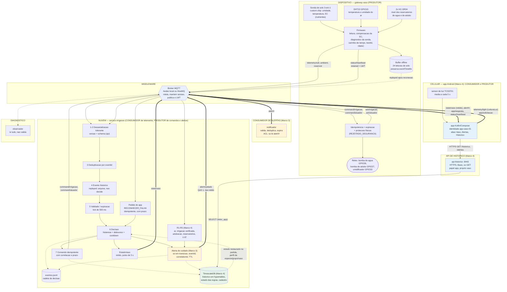

# Diagrama de componentes

Esboço arquitetural da fronteira. Cada caixa é um processo executável; cada
seta é uma publicação ou assinatura MQTT. A base é a do Marco 2; o par
**serviço → notificador** (Marco 3) aparece em destaque: o serviço **consome**
telemetria e **produz** comandos e alertas, e o notificador consome os alertas.
Explicação completa em [`marco-04.md`, §6](../marco-04.md#6-o-segundo-par-produtor-consumidor-serviço--notificador).
Os sensores e atuadores do Marco 4 (sonda 3-em-1, DHT22, HC-SR04, bomba de
adubo e umidificador) aparecem no dispositivo e usam os ramos `telemetry/#`,
`command/atuador` e `ack/atuador`; as regras estão descritas no `marco-04.md`.
O banco **TimescaleDB** (Marco 4) guarda o histórico, o estado das regras e o
cadastro; o serviço continua decidindo se ele cair. Ver [`persistencia.md`](../persistencia.md).

**Marco 4 — aplicativo (entregue).** O app Android é **mais um cliente do
broker** — lê o estado retido, os alertas e o heartbeat; **produz** a luz medida
pelo celular e os pedidos de reconhecimento de falha — e lê o histórico por uma
**API HTTPS somente leitura** sobre o banco. Ver [`aplicativo.md`](../aplicativo.md).

Até o Marco 3, o app aparecia tracejado, como evolução prevista: a escolha de
publicação e assinatura era justamente para que acrescentá-lo fosse acrescentar
um cliente, sem tocar no produtor. No Marco 4 isso se confirmou — o app entrou
sem mudar o dispositivo e sem mudar a regra de irrigação; o serviço ganhou só o
que é do app (estado retido, pedido/resposta, regra R5 da luz).

## Distribuição — onde cada parte roda e por quê

| Componente | Onde roda | Por que ali |
|---|---|---|
| Leitura, validação local, proteções físicas (intertravamento, reservatório crítico), idempotência e prazo do comando | **dispositivo** (ESP32 / simulador) | o que é **perigoso** precisa ser impedido mesmo sem rede |
| Broker MQTT (TLS, usuário/senha, ACL) | **servidor local** (PC) | ponto único por onde toda mensagem passa: lugar certo para barrar quem não deveria falar |
| Estado, regras R1–R5, decisão, alertas, estado retido para o app | **serviço** no servidor | o que é **desejável** decide quem vê o histórico e o contexto inteiro |
| Histórico, estado salvo, cadastro | **TimescaleDB** (Docker, só em 127.0.0.1) | sobrevive a reinício; só o serviço grava, só a API lê |
| API de histórico | **servidor**, ao lado do banco | o banco não sai da máquina; credencial do banco não vai para o celular |
| Tela, alertas, pedido de reconhecimento, **sensor de luz** | **celular** | é onde o usuário está — e o celular é o sensor de luz que fica junto da planta |
| Notificador, observador | servidor (terminal) | consumidores independentes: demonstram o desacoplamento |
