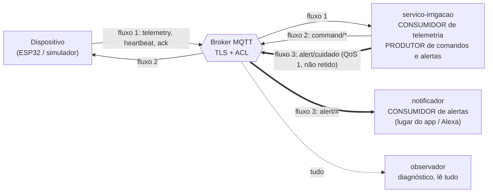

# Marco 4 — sensores, atuadores e regras novos

**Projeto:** *Não dê nem água* — cuidado assistido de plantas de interior
**Disciplina:** Software para Sistemas Ubíquos — UFG
**Integrantes:** Matheus Vieira Mendes Pacheco, Davi Duarte Neco, Bárbara Nogueira

O feedback do Marco 3 pediu **mais sensores** e uma solução **mais complexa**.
Este marco atende ao pedido **sem trocar a arquitetura**: tudo o que é novo
atravessa a mesma fronteira dispositivo ↔ nuvem do Marco 3, com os mesmos
compromissos (TLS, HMAC, contrato versionado, comando idempotente com prazo no
relógio do dispositivo, ack de negócio). O dispositivo continua medindo,
validando e atuando; o serviço continua guardando o estado e decidindo.

---

## 1. O que entrou

### Sensores

| Sensor | Onde | Grandeza | Real ou simulado |
|---|---|---|---|
| **Sonda de solo 3-em-1** | custom chip `sonda-solo` (Wokwi) | umidade (%), temperatura do substrato (°C), **condutividade elétrica** (µS/cm) = nutrientes | **Simulado** — o Wokwi não tem higrômetro nem sensor de EC; o chip foi escrito pelo grupo e os valores vêm de sliders |
| **DHT22** | GPIO 15 | temperatura e umidade do ar | componente do Wokwi (valor por slider) |
| **HC-SR04 ×2** | GPIO 5/18 e 17/16 | distância até a superfície → nível do reservatório de **água** e de **fertilizante** | componente do Wokwi (valor por slider) |

> **Declaração de substituto.** A sonda 3-em-1 substitui o potenciômetro dos
> marcos anteriores. Ela não mede nada: é um programa (`sonda-solo.chip.c`) que
> converte sliders em tensões. O que ela tem de útil é um **modelo físico
> declarado** — a EC que a sonda "enxerga" cai com o solo seco e sobe ~2 %/°C —
> e **falhas injetáveis** (desconectada, oxidada/travada, ruidosa). Isso obriga
> o firmware a compensar a leitura e a diagnosticar o sensor, em vez de só ler
> um número.

### Atuadores

| Atuador | Pino | Comando | Natureza |
|---|---|---|---|
| Bomba de água | GPIO 26 (relé) | `ComandoIrrigacao` (Marco 3) | pulso |
| **Bomba de fertilizante** | GPIO 27 (relé) | `ComandoAtuador` `BOMBA_ADUBO` `PULSO`/`DESLIGAR` | dose |
| **Umidificador** | GPIO 33 (relé) | `ComandoAtuador` `UMIDIFICADOR` `LIGAR`/`DESLIGAR` | **concessão** com prazo |
| LED de proteção local | GPIO 13 | — | aceso quando o dispositivo está bloqueando algo por conta própria |

---

## 2. Onde cada coisa roda

Mesma divisão da Atividade 02 (itens 10 e 11) e do Marco 3, estendida:

| Responsabilidade | Dispositivo | Serviço |
|---|:---:|:---:|
| Conversão da sonda, compensação da EC por temperatura e umidade | ✅ | |
| Diagnóstico da sonda (desconectada, fora da faixa, **travada**, **ruidosa**) | ✅ | |
| Mediana do ultrassom e nível em % | ✅ | |
| **Proteções físicas** (ver §4) | ✅ | |
| Média do ar, validade de cada dado, estados dos reservatórios | | ✅ |
| Regras R1–R4 e alertas | | ✅ |
| Verificação do **efeito** de cada atuação | | ✅ |

A regra que decide **o que é desejável** fica na nuvem. A regra que impede
**o que é perigoso** fica no dispositivo — é ele que tem o sensor e sofre a
consequência física, e ele precisa continuar seguro sem rede. É o mesmo
argumento que o Marco 3 usou para manter a idempotência no dispositivo.

---

## 3. Regras no serviço

### R1 — umidade do ar → umidificador (`ambiente.js`)

- Média móvel das últimas 3 leituras; validade de 10 s (relógio do serviço).
- Liga abaixo de 50 %; desliga acima de 60 % (histerese); tempo mínimo entre
  trocas de 6 s.
- **O `LIGAR` é uma concessão** (`durationMs` = 30 s). O dispositivo desliga
  sozinho quando ela vence; o serviço a renova na metade do prazo enquanto a
  condição durar. Se o serviço, o broker ou o dado sumirem, o umidificador não
  fica ligado para sempre — é o "silêncio não é normalidade" do Marco 3 aplicado
  a um atuador contínuo.
- DHT22 com `valid:false` → `DESLIGAR` + alerta `SENSOR_FALHOU`.

### R2 — irrigação (Marco 3 + `verificacao.js`)

A histerese, o debounce e o cooldown do Marco 3 não mudaram. Entraram três
coisas, todas via um `contexto` opcional em `decidir()` (sem contexto, o
comportamento é idêntico ao do Marco 3 — os 62 testes antigos continuam
passando):

1. **Bloqueio por reservatório:** com o reservatório de água `CRITICO`, o
   serviço não pede irrigação e, se a bomba estiver ligada, manda parar.
2. **Pedido da R3:** a adubação pode pedir água para preparar o solo.
3. **Verificação cruzada do efeito.** O Marco 3 distinguia *entregue* (PUBACK)
   de *executado* (ack). O Marco 4 pergunta **"a água chegou?"** — e responde
   com dois sensores independentes:

   | umidade subiu ≥ 3 pts | nível caiu ≥ 1 pt | diagnóstico |
   |:---:|:---:|---|
   | sim | sim | efeito confirmado |
   | não | não | `bomba_sem_fluxo` |
   | não | sim | `agua_nao_chegou_ao_vaso` (mangueira, vazamento) |
   | sim | não | `sensor_nivel_suspeito` |

   Sem confirmação em 15 s: alerta `FALHA_IRRIGACAO` (CRÍTICO) e **irrigação
   automática bloqueada** até reconhecimento (tecla `r` no serviço — o lugar do
   botão do app) ou por 2 min. Ligar de novo uma bomba que não bombeia só a
   queima.

### R3 — adubação (`adubacao.js`)

```
OCIOSO ──(gatilho; limite de doses ok; cooldown ok)
  ├─ solo < 35 % ──► AGUARDANDO_IRRIGACAO (pede água à R2) ──► AGUARDANDO_ABSORCAO ──► MEDINDO
  └─ solo na faixa ──────────────────────────────────────────────────────────────► MEDINDO
MEDINDO (média de 3 leituras de EC válidas, coletadas AGORA)
  ├─ ainda < 800 µS/cm ──► DOSANDO ──(ack EXECUTADO)──► VERIFICANDO
  └─ ≥ 800 ──────────────► OCIOSO  "falso_positivo_evitado"
VERIFICANDO ──(EC subiu ≥ 100 E nível do adubo caiu)──► OCIOSO + ADUBACAO_EXECUTADA
            ──(prazo)──► BLOQUEADA + FALHA_ADUBACAO
```

- **Dois gatilhos.** (A) EC compensada abaixo do mínimo. (B) *Suspeita*: com o
  solo seco a EC não é confiável (`ecValid:false`), mas a EC aparente está
  baixa. Pode ser só falta de água — por isso a R3 irriga, espera absorver e
  **mede de novo** antes de decidir. É o cenário em que um sistema ingênuo
  adubaria sem necessidade.
- **Nunca adubar solo seco** (queima a raiz), **no máximo 1 dose por janela**
  (7 dias em produção; 60 s na configuração de demonstração), **cooldown** entre
  tentativas.
- Sem ack no prazo, a dose é **assumida como aplicada** e conta no limite — a
  mesma suposição segura do Marco 3 para efeitos físicos.
- EC acima de 2000 µS/cm → `EXCESSO_NUTRIENTES`. O sistema **não atua**: a
  correção (lavar o substrato) é do usuário.

### R4 — reservatórios (`reservatorios.js`)

`OK` (> 25 %) / `BAIXO` (≤ 25 %) / `CRITICO` (≤ 10 %), com 3 pts de histerese
para sair de um estado pior. Alertas `RESERVATORIO_BAIXO`,
`RESERVATORIO_CRITICO` e `RESERVATORIO_NORMALIZADO`. Com o dado vencido, o
estado volta a `DESCONHECIDO` e o serviço **não bloqueia sozinho**: quem barra a
bomba a seco é o dispositivo, que tem o sensor.

---

## 4. Proteções físicas no dispositivo

Valem com ou sem rede e diante de **qualquer** comando, inclusive autêntico,
assinado e no prazo. Violação → ack `REJEITADO_SEGURANCA` com o motivo em
`detail` (e a chave idempotente **não** é registrada: se a condição mudar, um
reenvio é avaliado de novo).

| Comando | Recusado quando | `detail` |
|---|---|---|
| `PULSO_IRRIGACAO` | nível de água ≤ 10 % ou desconhecido | `reservatorio_agua_critico` / `nivel_agua_desconhecido` |
| | bomba de adubo ligada | `intertravamento_bomba_adubo` |
| `BOMBA_ADUBO PULSO` | nível de adubo ≤ 10 % ou desconhecido | `reservatorio_adubo_critico` / `nivel_adubo_desconhecido` |
| | bomba de água ligada | `intertravamento_bomba_agua` |
| | solo < 35 % ou sonda inválida | `solo_seco_nao_adubar` / `sonda_solo_invalida` |
| `UMIDIFICADOR LIGAR` | DHT22 com 3 falhas seguidas | `sensor_ar_invalido` |

E, a cada volta do `loop()`: a bomba para se o reservatório chegar ao crítico
no meio do pulso; o umidificador desliga se a concessão vencer ou o DHT22
falhar; dose e concessão têm teto (10 s e 120 s) mesmo que o comando peça mais.

---

## 5. Contrato — o que mudou na v1

Seguindo a regra de evolução do `contrato.md`: **acrescentar** mantém a versão;
nada foi removido, renomeado ou apertado.

| Mudança | Tipo | Tópico |
|---|---|---|
| `LeituraAmbiente` (novo) | evento novo | `.../telemetry/ambient` |
| `NivelReservatorio` (novo) | evento novo | `.../telemetry/reservoir` |
| `ComandoAtuador` (novo) | comando novo | `.../command/atuador` |
| `ConfirmacaoAtuacao` em `ack/atuador` | mesmo schema, tópico novo | `.../ack/atuador` |
| `LeituraUmidadeSolo` + `soilTempC`, `ecApparentUsCm`, `ec25UsCm`, `ecValid`, `ecInvalidReason` | campos **opcionais** | inalterado |
| `ConfirmacaoAtuacao.result` + `REJEITADO_SEGURANCA` | valor novo (como `REJEITADO_ASSINATURA` no Marco 3) | — |
| `AlertaCuidado.alertType` + 11 tipos | valores novos | inalterado |

**Por que `command/atuador` e não mais ações em `command/irrigacao`.** O nome do
tópico é parte da interface: um assinante do Marco 3 que escuta
`command/irrigacao` espera bomba de água. Pôr o umidificador ali mudaria o
significado de um tópico existente. Em ramo próprio, a ACL também autoriza cada
coisa separadamente (`seguranca/acl.json`).

**`sequence` único.** Solo, ar e nível usam o mesmo contador, então
`eventId = deviceId:bootId:sequence` continua único entre os três e o serviço
deduplica todos com o mesmo conjunto.

**Schemas condicionais.** `LeituraAmbiente` e `NivelReservatorio` só exigem os
valores quando `valid:true` — sem leitura confiável, o número é **omitido**,
nunca inventado. `ComandoAtuador` restringe as ações por atuador (`LIGAR` não
existe para a bomba de adubo; `PULSO` não existe para o umidificador).

### Exemplos

```json
{"schemaVersion":1,"eventId":"esp32-vaso-01:a1b2c3:000041","eventType":"LeituraUmidadeSolo",
 "deviceId":"esp32-vaso-01","entityId":"vaso-01","bootId":"a1b2c3","eventTimeMs":61500,"sequence":41,
 "value":55.0,"unit":"pct_simulado","valid":true,
 "soilTempC":24.0,"ecApparentUsCm":449,"ecValid":true,"ec25UsCm":500,"sig":"…"}
```

```json
{"schemaVersion":1,"commandId":"atu-000003","idempotencyKey":"atu-000003","commandType":"ComandoAtuador",
 "targetId":"vaso-01","actuator":"BOMBA_ADUBO","action":"PULSO","durationMs":2000,
 "correlationId":"esp32-vaso-01:a1b2c3:000047","correlationEventTimeMs":70500,
 "ttlMs":5000,"expiresAtDeviceMs":75500,"issuedAt":"2026-11-23T14:02:11.482Z",
 "reason":"ec_abaixo_minimo","sig":"…"}
```

---

## 6. O segundo par produtor-consumidor: serviço → notificador

> **Em uma frase.** A partir do Marco 3 o `servico-irrigacao` deixou de ser só
> consumidor: ele também **produz** eventos `AlertaCuidado`, e o
> **notificador** — um processo separado que faz o papel do aplicativo ou da
> Alexa — é o **consumidor** desse fluxo novo. No Marco 4 esse fluxo carrega
> também os 11 alertas novos (reservatórios, sensores, adubação, falha de
> irrigação).

O "novo produtor" **não é um processo novo**: é o mesmo serviço assumindo um
segundo papel. O que é novo é o **dado** (`AlertaCuidado`), o **tópico**
(`alert/cuidado`), o **consumidor** (`notificador`) e a **identidade** dele no
broker.

### Os fluxos da fronteira

| # | Produtor | Dado | Tópico | Consumidor | Desde |
|:---:|---|---|---|---|:---:|
| 1 | dispositivo | leituras (solo, ar, nível), heartbeat, acks | `telemetry/#`, `status/heartbeat`, `ack/#` | serviço | Marco 2 / 4 |
| 2 | serviço | comandos | `command/irrigacao`, `command/atuador` | dispositivo | Marco 2 / 4 |
| **3** | **serviço** | **`AlertaCuidado`** | **`alert/cuidado`** | **notificador** | **Marco 3 / 4** |



O serviço é o elo: ele **consome** o fluxo 1 e, a partir do estado que mantém,
**produz** os fluxos 2 (o que o vaso deve fazer) e 3 (o que a pessoa deve
saber).

### O que cada lado garante

| Produtor (`consumidor-servico/src/alertas.js`) | Consumidor (`notificador/src/main.js`) |
|---|---|
| `eventId` único: `servico-irrigacao:{execução}:{sequência}` | Desserialização tolerante: JSON malformado é descartado com motivo, sem derrubar o processo |
| Valida o próprio alerta contra o schema **antes** de publicar | Valida de novo: versão e schema `AlertaCuidado` v1 |
| `correlationId` aponta para a causa (o `eventId` da leitura ou o `commandId` do comando) | Confere a **origem**: vaso configurado e tópico `alert/cuidado` |
| Emite só nas **transições** (solo seco 3 vezes = 1 alerta) | **Deduplica** pelos últimos 500 `eventId` (QoS 1 pode entregar duas vezes) |
| `issuedAt` + `ttlMs` (60 s) | Descarta alerta **vencido**: um aviso velho não vira notificação |
| QoS 1, sem retain | Reconecta e refaz a assinatura sozinho |
| Pela ACL, só ele publica em `alert/` | Pela ACL, **só lê** `alert/#`: não consegue comandar a bomba |

A cadeia é auditável ponta a ponta: o cartão do notificador mostra o
`correlationId`, e o `eventos.jsonl` do serviço liga esse id à leitura ou ao
comando que gerou o alerta.

### Por que um processo separado, e não um `console.log` no serviço

1. **Falha isolada.** Notificador caído, lento ou recebendo lixo não atrasa nem
   para a irrigação. O serviço publica e segue, sem saber se alguém está ouvindo.
2. **Menor privilégio.** Quem mostra avisos ao usuário não precisa (nem pode)
   comandar atuadores. Num processo próprio isso vira **regra do broker**, e o
   ataque `npm run ataque -- notificador-comanda` mostra a recusa.
3. **Troca sem tocar no serviço.** Terminal hoje, app ou Alexa amanhã: troca-se
   o assinante, mantendo contrato e tópico. Vários consumidores podem assinar o
   mesmo alerta ao mesmo tempo.

### Notificador × observador

Os dois só leem, mas têm papéis diferentes:

| | Observador (Marco 2) | Notificador (Marco 3) |
|---|---|---|
| Para quem | o desenvolvedor | o usuário da planta |
| Assina | **tudo** (`{prefixo}/#`) | só `alert/#` |
| Valida contrato, deduplica, expira | não — imprime o que passa | **sim** |
| Papel | grampo de diagnóstico | consumidor de um contrato |

### Limitações deste fluxo

- **Alerta não é retido.** Notificador desligado perde os avisos daquele
  período. É uma escolha (aviso velho é ruído); um app real teria histórico.
- **Alerta sem HMAC.** No broker local só o serviço publica em `alert/` (ACL);
  no broker público, sem ACL, um terceiro poderia forjar um aviso. O efeito é
  informativo, não físico (ver `seguranca.md`, limitação 7).
- **Mão única.** O notificador não responde. Reconhecer uma falha (hoje a tecla
  `r` do serviço) exigirá um comando do app para o serviço — ver §9.
- Relógios do serviço e do notificador precisam estar sincronizados para o TTL.

### Como ver funcionando

Com os quatro terminais do README, cada tecla no simulador produz um cartão no
notificador:

| Tecla no simulador | Cartão no notificador |
|:---:|---|
| `s` | `ATENCAO — SOLO SECO`, depois `INFO — IRRIGACAO EXECUTADA` |
| `r` | `CRITICO — RESERVATORIO CRITICO` |
| `w` | `INFO — RESERVATORIO NORMALIZADO` |
| `f` depois `s` | `CRITICO — FALHA IRRIGACAO` |
| `h` | `INFO — UMIDIFICADOR ACIONADO` |
| `z` | `ATENCAO — SENSOR FALHOU` |
| `b` | `ATENCAO — EXCESSO NUTRIENTES` |
| `k` | `CRITICO — DISPOSITIVO OFFLINE` |

No `npm run teste`, a seção 8 cobre o par (acks fora de ordem, duplicatas,
expiração, lixo no tópico), a seção 11 prova que o notificador não publica e a
seção 18 confere que os alertas novos do Marco 4 chegam até ele.

---

## 7. Como demonstrar

**Caminho A (local, recomendado):** os quatro terminais do README. No simulador:

| Tecla | O que observar |
|---|---|
| `h` | ar a 35 % → `UMIDIFICADOR LIGAR` (concessão) → ar sobe → `DESLIGAR` |
| `z` | DHT22 falha → `SENSOR_FALHOU`, umidificador desliga |
| `r` depois `s` | reservatório crítico → `RESERVATORIO_CRITICO`; solo seco **não** gera pulso |
| `w` | reabastece → irrigação volta e o log do serviço mostra `efeito confirmado` |
| `n` (com solo úmido) | EC 500 → MEDINDO → dose → `ADUBACAO_EXECUTADA` |
| `s` com EC normal | falso positivo: irriga, mede de novo e **não** aduba |
| `f` depois `s` | bomba sem fluxo → `FALHA_IRRIGACAO`, irrigação bloqueada; `r` no serviço libera |
| `b` | EC 2500 → `EXCESSO_NUTRIENTES` |

**Caminho B (Wokwi):** `produtor-esp32/` traz `sketch.ino`, `diagram.json`,
`sonda_solo.h`, `reservatorios.h` e o custom chip (`sonda-solo.chip.json` e
`sonda-solo.chip.c`). Bibliotecas: **PubSubClient** e **DHT sensor library for
ESPx**. No Wokwi não há física: quem "rega" é quem move o slider da sonda e do
HC-SR04 durante o pulso.

---

## 8. Limitações declaradas

1. **Nenhuma grandeza nova é medida de verdade.** Sonda por custom chip; DHT22 e
   HC-SR04 por slider; no simulador Node, uma física simples declarada.
2. **O firmware do Marco 4 não foi compilado nesta máquina** (sem toolchain
   ESP32 local). O formato de todas as mensagens que ele monta foi conferido
   contra os schemas, mas a primeira compilação acontece no Wokwi.
3. **O buffer offline só guarda o solo** (sem os campos de EC). Ar e nível são
   estado corrente; um replay não decide nada no serviço.
4. **Comandos de atuador ancorados em evento antigo podem chegar vencidos** —
   por exemplo o `DESLIGAR` emitido quando o dado do ar expira. É por isso que o
   umidificador funciona por concessão: ele desliga de qualquer jeito.
5. ~~**Um vaso, uma espécie.**~~ **Resolvida:** os limiares vêm do perfil de
   cuidado da espécie, do grupo e do vaso, guardados no banco e aplicados sem
   reiniciar o serviço → [`persistencia.md`, §5](persistencia.md#5-perfil-de-cuidado-por-espécie-grupo-e-vaso).
   O serviço ainda atende um vaso por processo.
6. ~~**Estado em memória.**~~ **Resolvida:** histórico em TimescaleDB e
   snapshot do estado das regras restaurado na partida — doses, bloqueios,
   deduplicação e contadores sobrevivem a um `SIGKILL` →
   [`persistencia.md`](persistencia.md). Limitações da persistência em §7 de lá.

---

## 9. Próximo passo: o aplicativo

> **Atualização:** o backend do app está pronto — identidade e papel `app` na
> ACL, estado corrente retido (`EstadoVaso`), o caminho de volta
> (`SolicitacaoApp` → `RespostaApp`, que substitui a tecla `r`) e a seção 19 de
> testes. Ver [`aplicativo.md`](aplicativo.md). O texto abaixo é o plano original.

O app previsto entra como **mais um assinante**, sem mudar produtor nem
serviço. Para os avisos ele ocupa o lugar do **notificador** (§6): consome
`AlertaCuidado` em `alert/#` com as mesmas validações. Para mostrar o estado
corrente (nível dos reservatórios, umidade), assina também a telemetria, como o
`observador` faz hoje. O que ainda não existe é o caminho de volta: o
**reconhecimento de falha** (hoje a tecla `r` do serviço) precisará de um
comando próprio do app para o serviço. O sensor do celular previsto é o de
**luz ambiente** (Android `Sensor.TYPE_LIGHT`, em lux), para escolher o melhor
lugar do vaso e calibrar o sensor de luz do dispositivo.
